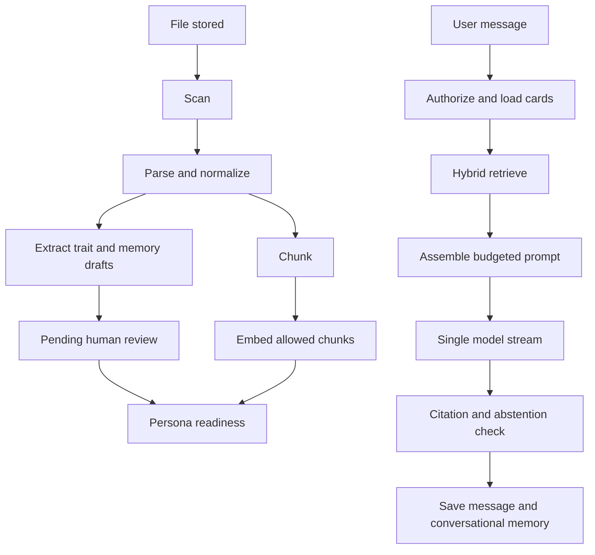

# Orchestration

Ingestion is a queue of deterministic stages. Chat is one retrieval and one completion. Review is a status change, not an agent.

There is no planner, critic, or tool-using agent on either path.
