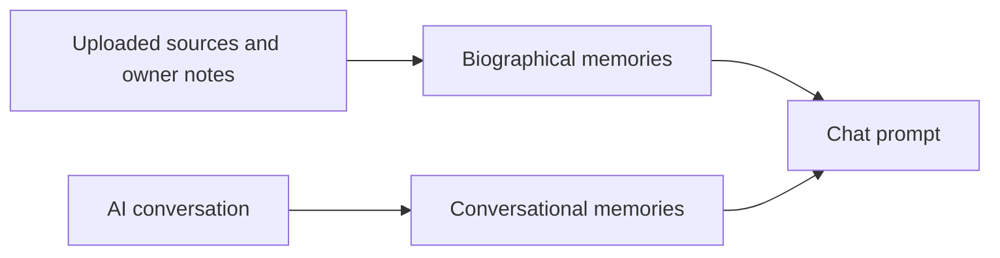

# Memory separation

Conversational memories may enter the prompt only as history of this user with the simulation. They are never written into the biographical table and never described as events in the person's life.

Retrieval functions are separate: `searchBiographical` and `searchConversational`.
