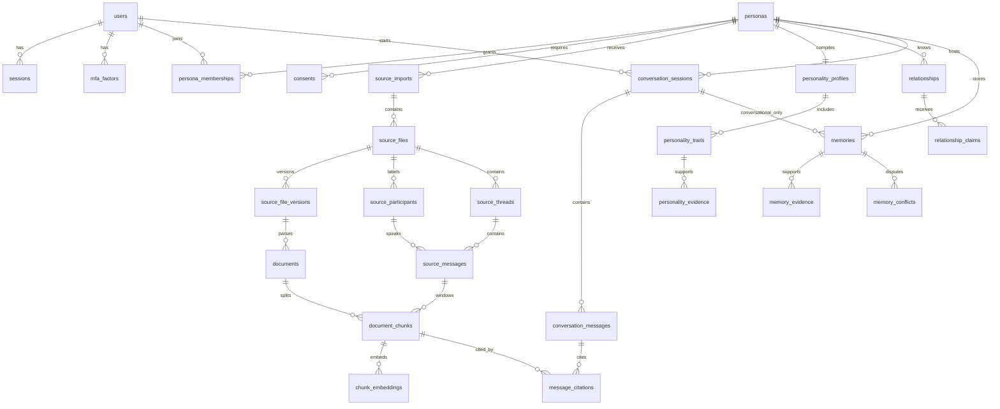

# Entity relationship

Candidate tables from the brief that do not appear here were merged or deferred. Evaluation runs are Phase 4. Voice profiles are Version 2. Both are omitted from the MVP diagram.

`memories.domain` is `biographical` or `conversational`. The conversational link to `conversation_sessions` is required only for that domain. Biographical memories point at `memory_evidence`, not at chat sessions.
