# Sequence diagrams

Participants are the browser, Next.js web app, NestJS API, worker, Postgres, object storage, and the allowlisted model provider.

## 1. Registration and login

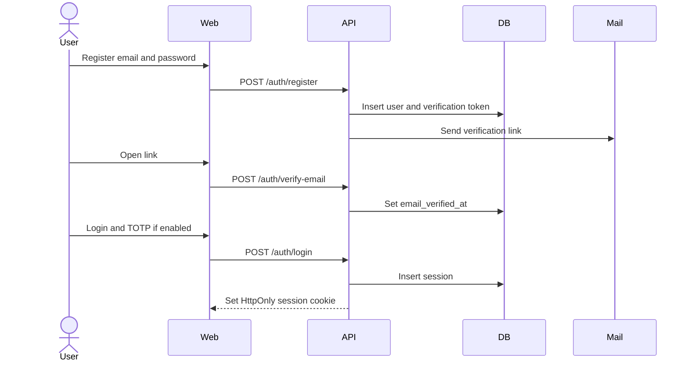

## 2. Persona creation

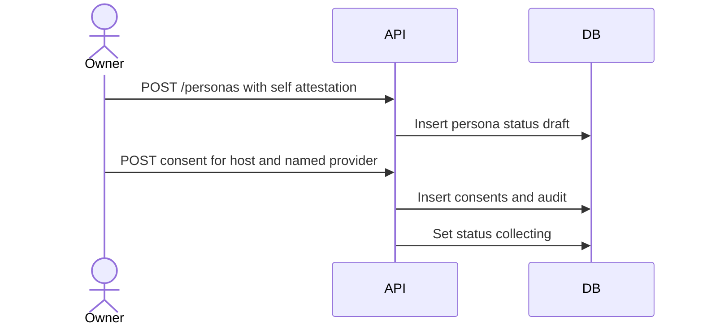

## 3. Authorization and consent

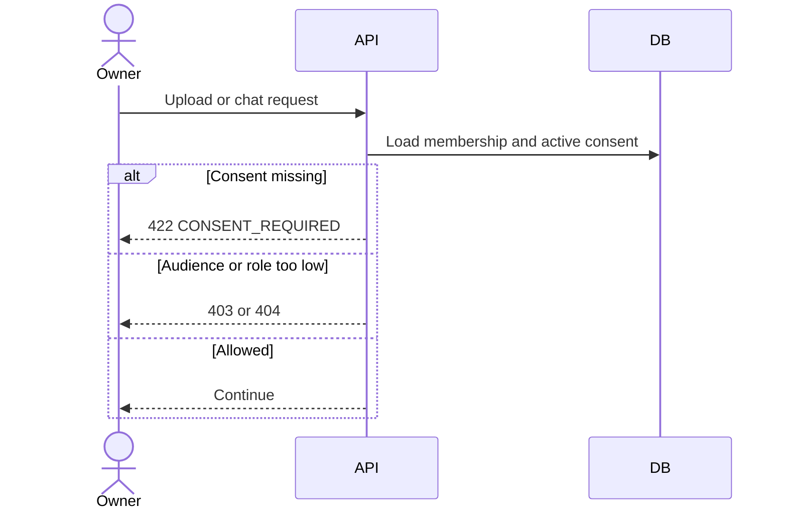

Legacy personas remain non-conversational until an authorization attestation exists. A dispute sets `suspended`.

## 4. Upload and validation

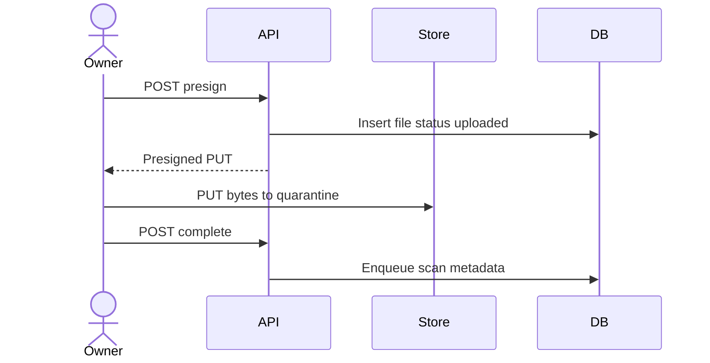

## 5. Parse

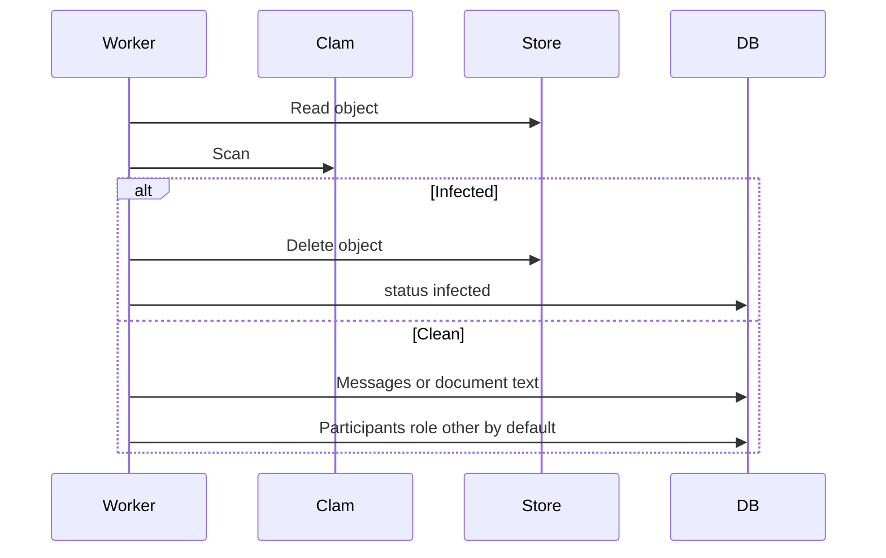

## 6. Personality extraction

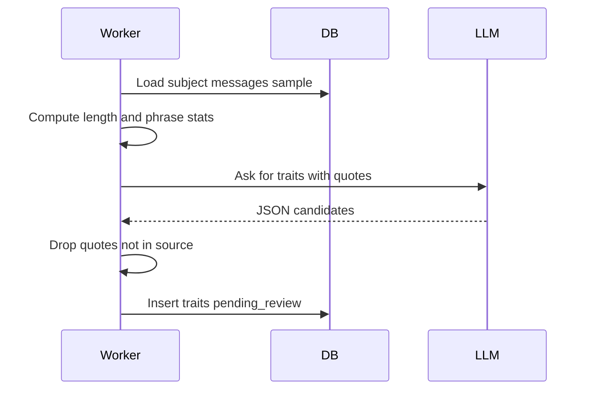

## 7. Memory extraction

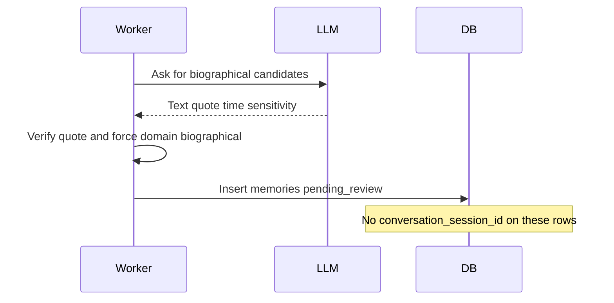

## 8. Embeddings

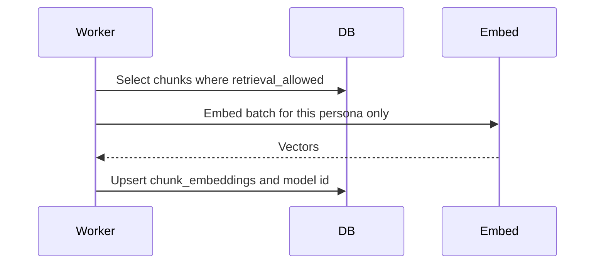

## 9. Send a chat message

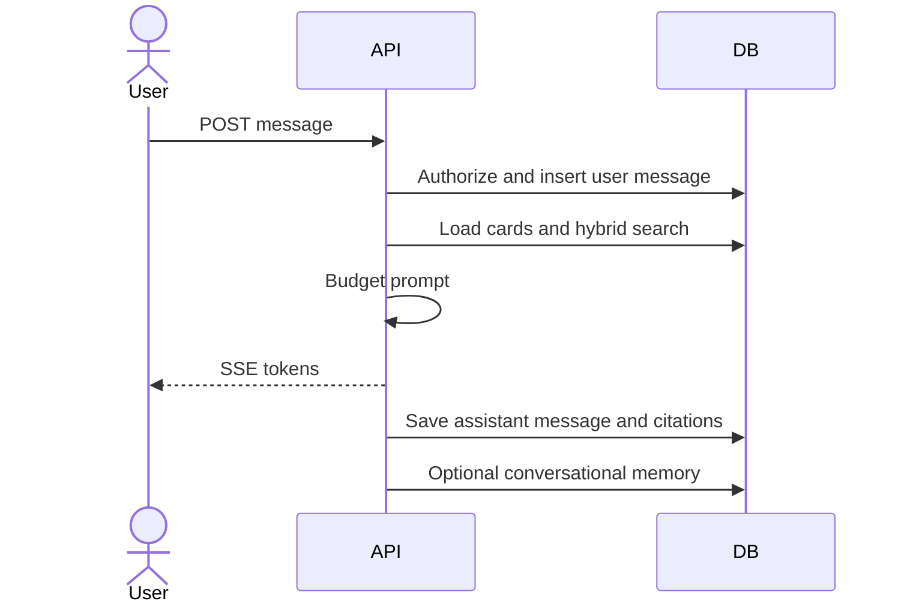

## 10. RAG and generation

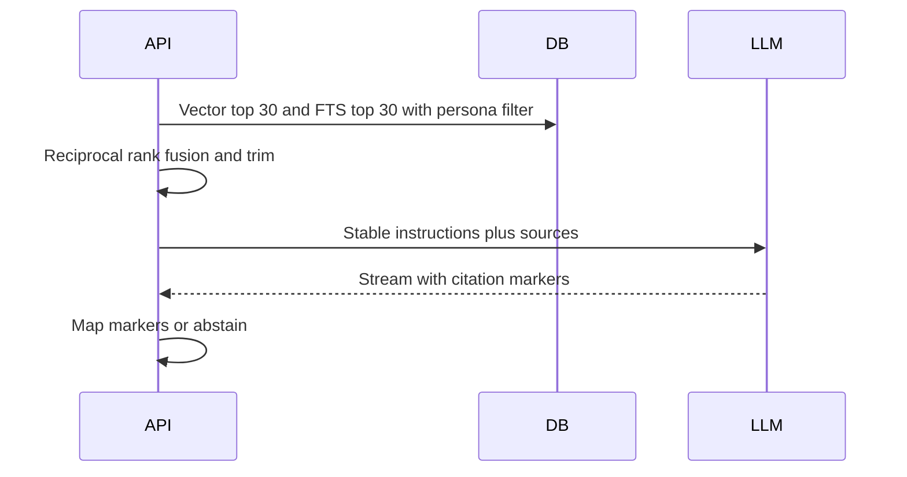

## 11. Relationship-aware reply

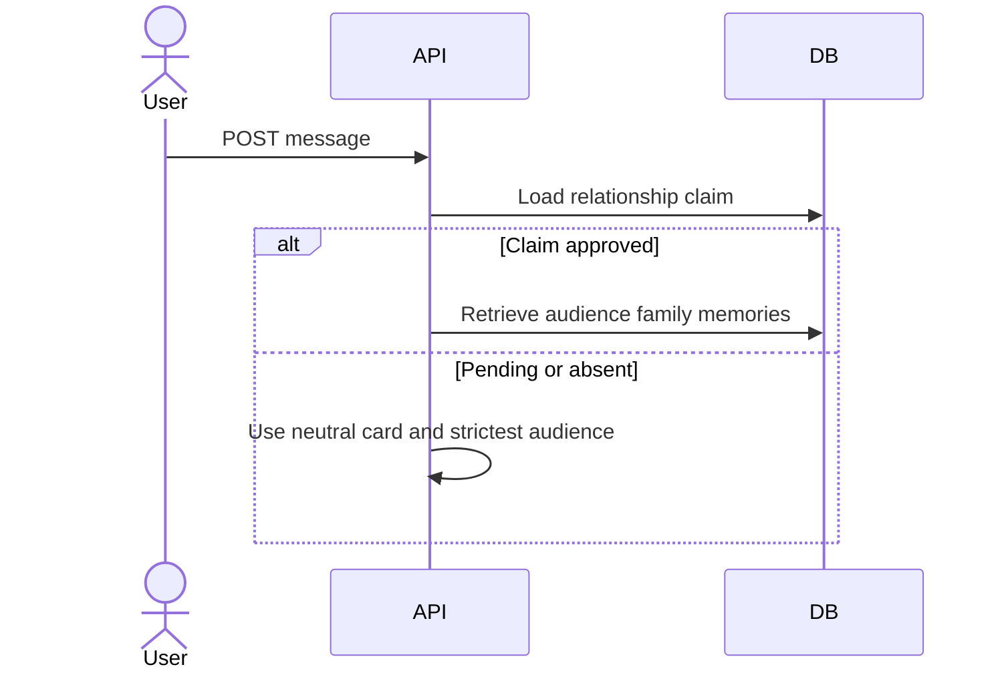

Phase 4 behavior. The MVP uses the membership audience only.

## 12. Real-time voice (Version 2 — held)

Version 1 has no voice sequence. Text chat is sequence 9–11.

When Version 2 opens:

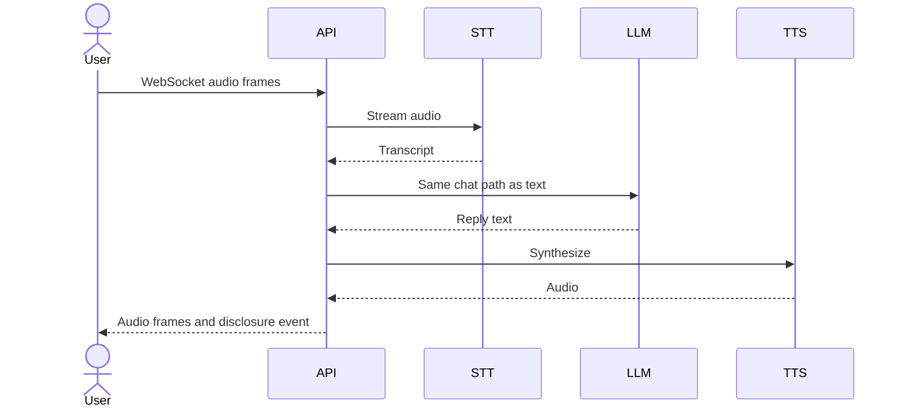

Version 2a instead uploads a finished recording and returns text, then optional stock TTS. Custom cloned voice is not this diagram and stays gated.

## 13. Add material to an existing persona

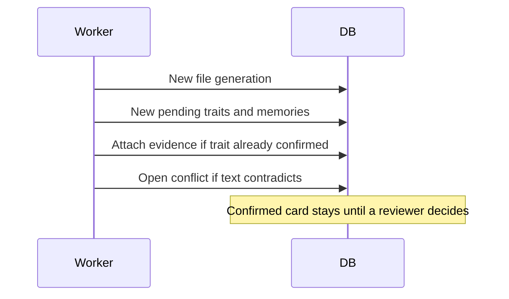

## 14. Correct a memory

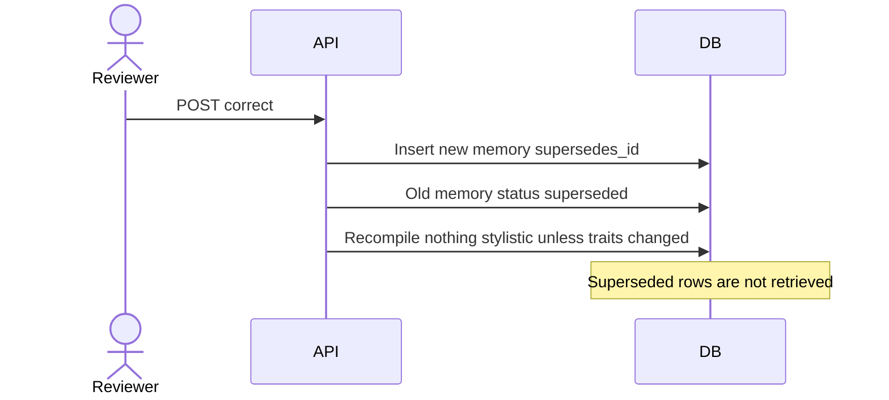

## 15. Revoke a source

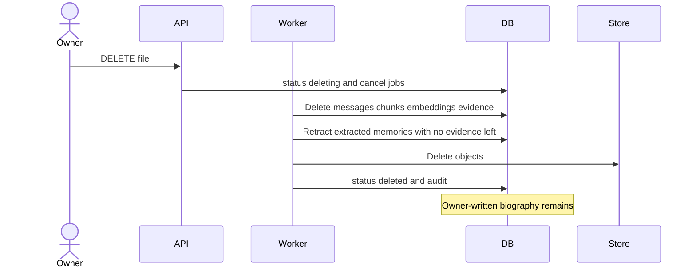
